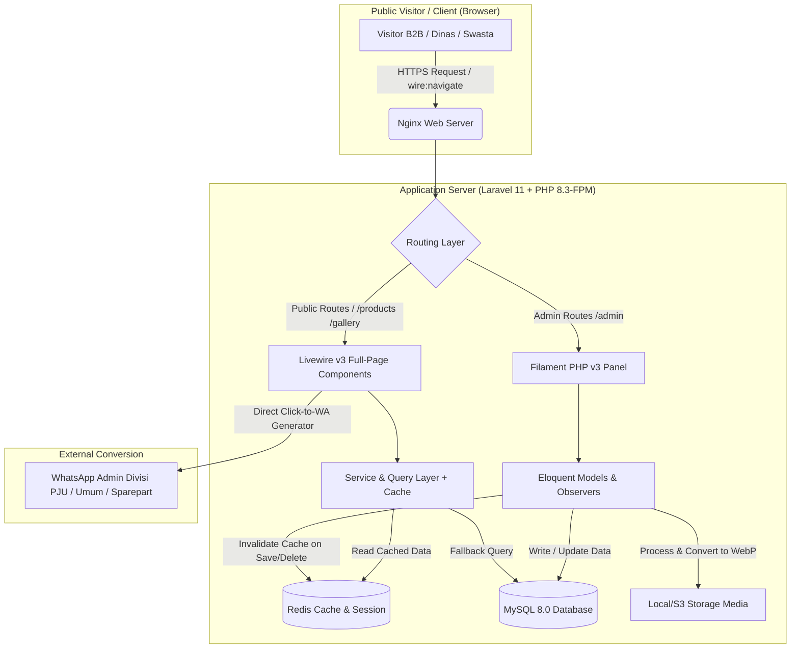

# SYSTEM ARCHITECTURE, FOLDER STRUCTURE & TALL + FILAMENT V3 BLUEPRINT
**Proyek:** Corporate Web Portal & Digital Product Showcase PT. Multi Abadi Aksana  
**Referensi Flow & UX:** `cvniscahya.com`  
**Tech Stack:** Laravel 11, Livewire v3, Alpine.js, Tailwind CSS, Filament PHP v3  
**Target Environment:** Linux VPS (Ubuntu 24.04 LTS, Nginx, PHP 8.3-FPM, MySQL 8.0+, Redis)  

---

## 1. High-Level System Architecture

Arsitektur aplikasi ini dirancang menggunakan pendekatan **Modular Monolith berbasis TALL Stack** dengan pemisahan yang tegas antara *Public Showcase Layer* (Livewire v3 + Blade + Alpine.js) dan *Backoffice CMS Layer* (Filament PHP v3).



### Prinsip Arsitektur Utama:
1. **SPA-like Navigation (`wire:navigate`):** Seluruh perpindahan halaman publik (`Beranda` $\leftrightarrow$ `Produk` $\leftrightarrow$ `Detail Produk` $\leftrightarrow$ `Galeri` $\leftrightarrow$ `Blog` $\leftrightarrow$ `Kontak`) menggunakan fitur `wire:navigate` dari Livewire v3 agar terasa instan tanpa *full browser reload*, persis seperti pengalaman di `cvniscahya.com`.
2. **Cache-First Public Catalog:** Karena web ini bersifat *read-heavy* (pengunjung melihat profil, layanan, dan katalog produk tanpa transaksi *checkout*), kueri utama disimpan di **Redis** dan hanya di-reset otomatis melalui **Eloquent Model Observers** ketika Admin mengubah data di Filament v3.
3. **Contextual WhatsApp Routing:** Sistem memiliki *Helper/Service* khusus (`WhatsAppLinkGenerator`) yang secara cerdas memilih nomor WA tujuan berdasarkan kategori produk (misal: produk kategori *Sparepart & Equipment* otomatis diarahkan ke `+62 812-1659-2824`, sedangkan *PJU, ME, & Interior* diarahkan ke nomor utama `+62 823-4297-9898`).

---

## 2. Daftar Tech Stack & Composer Packages

Berikut adalah daftar *dependencies* resmi yang wajib di-install pada `composer.json` dan `package.json`:

### 2.1 Backend Dependencies (`composer.json`)
| Package | Versi | Fungsi Utama dalam Proyek |
| :--- | :--- | :--- |
| `laravel/framework` | `^11.0` | Core PHP Framework. |
| `livewire/livewire` | `^3.5` | Reactive Frontend Components untuk katalog, filter, dan form kontak. |
| `filament/filament` | `^3.2` | Admin Panel CMS (`/admin`) untuk mengelola seluruh produk, layanan, galeri, dan blog. |
| `spatie/laravel-settings` | `^3.3` | Menyimpan konfigurasi global perusahaan (Nomor WA, Alamat Sidoarjo, Statistik Beranda). |
| `filament/spatie-laravel-settings-plugin` | `^3.2` | Integrasi halaman pengaturan `spatie/laravel-settings` langsung di dalam menu Filament. |
| `intervention/image-laravel` | `^1.3` | Konversi otomatis foto produk & foto *Projek On Duty* ke format `.webp` saat di-upload. |
| `artesaos/seotools` | `^1.3` | Manajemen *Meta Title*, *Meta Description*, *Canonical URL*, dan *OpenGraph* dinamis. |
| `spatie/laravel-sitemap` | `^7.2` | Generate `sitemap.xml` otomatis untuk seluruh URL produk (`/products/{slug}`) dan blog. |

### 2.2 Frontend Dependencies (`package.json`)
* `tailwindcss` (`^3.4`), `@tailwindcss/forms`, `@tailwindcss/typography`
* `alpinejs` (Sudah *built-in* bersama Livewire v3, digunakan untuk *image gallery switcher* di halaman detail produk, *lightbox* galeri proyek, dan *mobile navbar*).
* `autoprefixer`, `postcss`, `vite`.

---

## 3. Struktur Direktori Proyek (Folder Structure)

Struktur folder dirancang bersih, terstandarisasi, dan mudah di-*maintain* oleh tim *engineer*:

```text
multi-abadi-aksana/
├── app/
│   ├── Enums/
│   │   ├── InquiryPipelineStatus.php      # Enum: komunikasi, survei, negosiasi, deal, batal
│   │   ├── ServiceScopeType.php           # Enum: barang, jasa
│   │   └── ProductAvailability.php        # Enum: Tersedia, Pre-Order, Custom Fabrikasi
│   │
│   ├── Filament/
│   │   ├── Pages/
│   │   │   └── ManageCompanySettings.php  # Halaman edit WA, Alamat, Visi Misi, Statistik
│   │   ├── Resources/
│   │   │   ├── ServicePillarResource.php  # CRUD 4 Pilar + RelationManager Barang & Jasa
│   │   │   ├── ProductCategoryResource.php# CRUD Kategori Filter Katalog
│   │   │   ├── ProductResource.php        # CRUD Katalog Produk (Repeater Spek & Keunggulan)
│   │   │   ├── GalleryResource.php        # CRUD Dokumentasi "Projek On Duty"
│   │   │   ├── PostResource.php           # CRUD Artikel Blog & SEO
│   │   │   └── ContactInquiryResource.php # Manajemen Leads & Pipeline (Komunikasi -> Deal)
│   │   └── Widgets/
│   │       ├── StatsOverviewWidget.php    # Ringkasan Total Produk, Proyek, & Pesan Masuk
│   │       └── LatestInquiriesWidget.php  # Tabel pesan konsultasi terbaru di Dashboard
│   │
│   ├── Livewire/
│   │   ├── Pages/
│   │   │   ├── HomePage.php               # Beranda (/)
│   │   │   ├── AboutPage.php              # Tentang Kami & Rincian Barang/Jasa (/about)
│   │   │   ├── ProductCatalogPage.php     # Katalog + Filter Kategori Livewire (/products)
│   │   │   ├── ProductDetailPage.php      # Detail Produk + Spek + WA CTA (/products/{slug})
│   │   │   ├── GalleryPage.php            # Galeri Projek On Duty + Lightbox (/gallery)
│   │   │   ├── BlogIndexPage.php          # Daftar Artikel (/blog)
│   │   │   ├── BlogDetailPage.php         # Baca Artikel (/blog/{slug})
│   │   │   └── ContactPage.php            # Halaman Kontak + Form Inquiry (/contact)
│   │   └── Components/
│   │       ├── Navbar.php                 # Navigasi Utama
│   │       ├── Footer.php                 # Footer Korporat Dinamis
│   │       ├── ProductCard.php            # Reusable Card Produk (Foto, Badge, Judul, Tombol Detail)
│   │       └── FloatingWhatsApp.php       # Tombol WA Melayang (Pilih Divisi Umum / Sparepart)
│   │
│   ├── Models/
│   │   ├── ServicePillar.php
│   │   ├── ServiceScope.php
│   │   ├── ProductCategory.php
│   │   ├── Product.php
│   │   ├── Gallery.php
│   │   ├── PostCategory.php
│   │   ├── Post.php
│   │   └── ContactInquiry.php
│   │
│   ├── Observers/
│   │   ├── ProductObserver.php            # Auto-clear cache katalog & generate slug
│   │   ├── ServicePillarObserver.php      # Auto-clear cache layanan
│   │   └── GalleryObserver.php            # Auto-clear cache galeri
│   │
│   ├── Services/
│   │   ├── WhatsAppGeneratorService.php   # Merakit URL wa.me + pre-filled message per produk/divisi
│   │   └── SeoService.php                 # Set meta tags dinamis per halaman
│   │
│   └── Settings/
│       └── CompanySettings.php            # Spatie Settings Class
│
├── database/
│   ├── migrations/                        # Urutan file migrasi sesuai Dokumen 02 (ERD)
│   └── seeders/
│       ├── DatabaseSeeder.php
│       ├── CompanySettingsSeeder.php      # Seed data kontak, alamat Sidoarjo, & statistik
│       ├── ServicePillarSeeder.php        # Seed 4 Pilar + seluruh item Barang & Jasa dari PDF
│       ├── ProductCatalogSeeder.php       # Seed Produk PJU (All in One, Two in One, PLN), ME, Interior, Sparepart
│       └── GallerySeeder.php              # Seed data "Projek On Duty" (Gempol-Sidoarjo, Adelle, PGIC-E34)
│
├── resources/
│   ├── css/
│   │   └── app.css                        # Konfigurasi Tailwind CSS & Custom Utility
│   ├── js/
│   │   └── app.js                         # Inisialisasi Alpine.js tambahan
│   └── views/
│       ├── components/
│       │   └── layouts/
│       │       └── app.blade.php          # Master Layout Publik (Navbar, Slot, Footer, Floating WA)
│       └── livewire/
│           ├── pages/                     # View untuk masing-masing halaman Livewire
│           └── components/                # View untuk ProductCard, Navbar, Footer
│
└── routes/
    └── web.php                            # Definisi seluruh route publik
```

---

## 4. Rancangan Routing & Livewire Components (`routes/web.php`)

Seluruh *routing* publik mengikuti pola URL bersih seperti pada `cvniscahya.com`:

```php
<?php

use Illuminate\Support\Facades\Route;
use App\Livewire\Pages\HomePage;
use App\Livewire\Pages\AboutPage;
use App\Livewire\Pages\ProductCatalogPage;
use App\Livewire\Pages\ProductDetailPage;
use App\Livewire\Pages\GalleryPage;
use App\Livewire\Pages\BlogIndexPage;
use App\Livewire\Pages\BlogDetailPage;
use App\Livewire\Pages\ContactPage;

Route::get('/', HomePage::class)->name('home');
Route::get('/about', AboutPage::class)->name('about');

// Katalog & Detail Produk (Non-Ecommerce Showcase)
Route::get('/products', ProductCatalogPage::class)->name('products.index');
Route::get('/products/{slug}', ProductDetailPage::class)->name('products.show');

// Galeri Dokumentasi "Projek On Duty"
Route::get('/gallery', GalleryPage::class)->name('gallery.index');

// Wawasan & Edukasi (Blog)
Route::get('/blog', BlogIndexPage::class)->name('blog.index');
Route::get('/blog/{slug}', BlogDetailPage::class)->name('blog.show');

// Kontak & Konsultasi Proyek
Route::get('/contact', ContactPage::class)->name('contact');
```

### Detail Perilaku Komponen Kunci Livewire v3:

1. **`ProductCatalogPage.php` (`/products`):**
   * Menggunakan atribut `#[Url(as: 'kategori', except: 'semua')]` pada properti `$selectedCategory` dan `#[Url(as: 'cari', except: '')]` pada properti `$search`.
   * Ketika pengunjung mengklik *pill* kategori (misal: `PJU Tenaga Surya` atau `Sparepart & Equipment`), URL di browser otomatis berubah menjadi `/products?kategori=pju-tenaga-surya` secara reaktif tanpa memuat ulang halaman.
   * Merender daftar produk menggunakan komponen `<x-product-card :product="$product" />` yang hanya menampilkan: **Foto, Badge Sub-Kategori, Nama Produk, dan Tombol "Detail"**.

2. **`ProductDetailPage.php` (`/products/{slug}`):**
   * Mengambil data produk berdasarkan `slug` beserta relasi `category.servicePillar`.
   * Menggunakan **Alpine.js** (`x-data="{ activeImage: '...' }"`) untuk mengganti gambar utama saat *thumbnail* galeri produk diklik.
   * Memanggil `WhatsAppGeneratorService::forProduct($product)` untuk menghasilkan tautan tombol **"WhatsApp Admin"** yang otomatis mengarah ke nomor WA divisi terkait dengan teks:
     > *"Halo Admin PT. Multi Abadi Aksana, saya ingin meminta informasi detail dan konsultasi mengenai produk: *[Nama Produk]* (Kategori: [Nama Kategori]). Link: [URL Produk]"*
   * Merender seksi:
     1. **Deskripsi Produk** (`description`)
     2. **Mengapa Harus [Nama Produk]?** (`why_choose_text`)
     3. **Tabel Spesifikasi Teknis** (melakukan *looping* pada JSON `specifications` berisi `label` dan `value`)
     4. **Poin Keunggulan Produk** (melakukan *looping* pada JSON `advantages`)
     5. **Unit Terkait** (4 produk lain di kategori yang sama).

---

## 5. Blueprint Arsitektur Filament PHP v3 (`/admin`)

Panel Admin diakses melalui `/admin` dan dikelompokkan ke dalam 4 *Navigation Group* agar rapi bagi staf admin PT. Multi Abadi Aksana:

### Group 1: Katalog & Layanan
1. **`ProductResource` (Menu: "Produk & Material"):**
   * Menggunakan *Form Tabs* di Filament v3 agar input data produk yang kaya spesifikasi tetap ringkas:
     * **Tab 1: Informasi Dasar:**
       * `Select::make('product_category_id')` (Relasi ke Kategori Produk).
       * `TextInput::make('name')` (Live *auto-generate* ke `slug`).
       * `TextInput::make('sub_badge')` (Placeholder: *All In One, Two In One, Konvensional, PJU PLN, Sparepart, Impeller*).
       * `TextInput::make('brand')` (Placeholder: *COB, Osram, Philips, Estika*).
       * `Select::make('availability_status')` (`Tersedia`, `Pre-Order`, `Custom Fabrikasi`).
       * `Toggle::make('is_featured')` (*Tampilkan di Produk Unggulan Beranda*).
       * `Toggle::make('has_warranty_badge')` (*Tampilkan Badge Bergaransi*).
       * `Toggle::make('has_eco_k3_badge')` (*Tampilkan Badge Standar Mutu & K3*).
     * **Tab 2: Media & Galeri Foto:**
       * `FileUpload::make('thumbnail_image')` (Gambar utama, rasio 4:3 atau 1:1, otomatis WebP).
       * `FileUpload::make('gallery_images')->multiple()->reorderable()` (Galeri foto sudut pandang produk).
     * **Tab 3: Konten & Penjelasan:**
       * `Textarea::make('short_summary')` (Ringkasan 2 kalimat di sebelah kanan foto).
       * `RichEditor::make('description')` (Deskripsi lengkap produk).
       * `RichEditor::make('why_choose_text')` (Konten seksi *"Mengapa Harus Produk Ini?"*).
     * **Tab 4: Spesifikasi Teknis & Keunggulan (Dynamic JSON Repeaters):**
       * `Repeater::make('specifications')` dengan 2 kolom sejajar:
         * `TextInput::make('label')` (Contoh: *Daya Lampu*, *Tipe Baterai*, *Material Tiang*, *Viskositas Oli*)
         * `TextInput::make('value')` (Contoh: *100W LED*, *LiFePO4*, *Octagonal Galvanis*, *SAE 15W-40*)
       * `Repeater::make('advantages')` dengan 1 kolom:
         * `TextInput::make('point')` (Contoh: *Menghemat biaya operasional listrik PLN hingga 100%*)
2. **`ProductCategoryResource` (Menu: "Kategori Produk"):**
   * Mengatur daftar tombol filter yang tampil di halaman `/products`.
3. **`ServicePillarResource` (Menu: "4 Pilar Layanan"):**
   * Dilengkapi **`ServiceScopesRelationManager`** sehingga di dalam 1 halaman edit Pilar (misal: *Penerangan Jalan Umum*), admin bisa langsung menambah/mengedit daftar **Pengadaan Barang** dan **Pengadaan Jasa**.

### Group 2: Portofolio & Publikasi
4. **`GalleryResource` (Menu: "Galeri Projek On Duty"):**
   * Input dokumentasi proyek lapangan, kode unit/klien (`Adelle Jewellery`, `PGIC-E34`, `Ruas Gempol-Sidoarjo`), lokasi, dan foto kegiatan.
5. **`PostResource` & `PostCategoryResource` (Menu: "Artikel & Blog"):**
   * Manajemen artikel edukasi dan berita perusahaan.

### Group 3: Interaksi Klien (CRM Ringan)
6. **`ContactInquiryResource` (Menu: "Pesan & Konsultasi"):**
   * Menampilkan pesan masuk dari halaman `/contact` dengan badge warna status sesuai tahapan bisnis PT. Multi Abadi Aksana:
     * `Komunikasi` (Biru - *Info*)
     * `Survei` (Kuning - *Warning*)
     * `Negosiasi` (Ungu - *Primary*)
     * `Deal` (Hijau - *Success*)
     * `Batal` (Merah - *Danger*)

### Group 4: Pengaturan Sistem
7. **`ManageCompanySettings` (Menu: "Pengaturan Perusahaan"):**
   * Mengelola Nomor WA Utama, Nomor WA Sparepart, Email `ptmultiabadiaksana15@gmail.com`, Alamat Head Office (Taman, Sidoarjo), Alamat Workshop (Sukodono, Sidoarjo), Angka Statistik Beranda, serta upload file PDF Company Profile terbaru.

---

## 6. Rencana Master Data Seeder (`DatabaseSeeder`)

Agar begitu proyek di-install (`php artisan migrate --seed`) website langsung terisi penuh sesuai ke-3 PDF klien tanpa harus input manual satu per satu dari nol, kita menyiapkan 4 *Seeder* utama:

1. **`CompanySettingsSeeder`:**
   * Mengisi otomatis visi, misi, tagline keberlanjutan & K3, alamat kantor Sidoarjo, email resmi, dan kedua nomor WhatsApp.
2. **`ServicePillarSeeder`:**
   * Mengisi 4 Pilar (**Penerangan Jalan Umum**, **Interior & Exterior**, **Mechanical & Electrical**, **Sparepart & Equipment**) beserta seluruh poin *Pengadaan Barang* dan *Pengadaan Jasa* persis kata demi kata dari PDF *ComPro MULTI ABADI AKSANA*.
3. **`ProductCatalogSeeder`:**
   * Mengisi kategori dan sampel produk awal lengkap dengan spesifikasi & keunggulannya:
     * **Kategori PJU Tenaga Surya:** *PJU Solar Cell All In One*, *PJU Solar Cell Two In One*, *PJU Solar Cell Konvensional (Split System)*.
     * **Kategori PJU PLN & Tiang:** *Lampu PJU PLN LED (COB / Osram / Philips / Estika)*, *Tiang PJU PLN Parabola*, *Tiang PJU Tenaga Surya Klem Fleksibel*, *Tiang Octagonal & High Mast*.
     * **Kategori Mechanical & Electrical:** *Panel Distribusi Utama (MDP/SDP) & ATS/AMF*, *Industrial Impeller & Suku Cadang Mekanikal*, *Transformator, Genset & UPS*, *Kabel Distribusi (NYA/NYM/NYY/XLPE) & Cable Tray*.
     * **Kategori Interior & Exterior:** *Wall Panel WPC/PVC & Gypsum Board*, *Lantai Vinyl, SPC & Parket*, *Custom Furniture & Partisi Kaca/Cubicle*, *Fasad ACP & Kanopi Eksterior*.
     * **Kategori Sparepart & Equipment:** *Oli & Grease Industri/Alat Berat*, *Ban Luar & Ban Dalam Alat Berat*, *Aki, Filter & Komponen Mesin*, *Bearing, Baut Roda & Kampas Kopling*.
4. **`GallerySeeder`:**
   * Mengisi data awal galeri **Projek On Duty** berdasarkan dokumentasi di PDF (Proyek PJU Gempol-Sidoarjo-Malang, Proyek Interior Adelle Jewellery, Proyek Betonisasi Sidoarjo, dan Penanganan Unit Alat Berat `PGIC-E34` & `PGIC-AB0`).